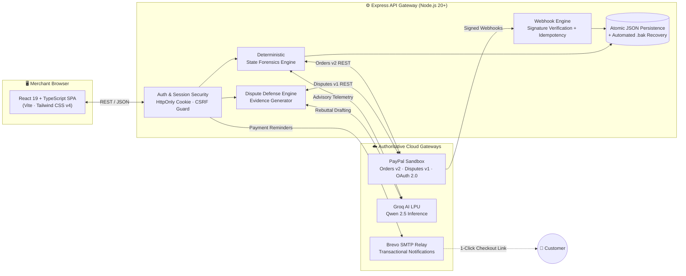

<div align="center">

# 🤖 Transaction-Autopilot

### PayPal Commerce Merchant Portal & Autonomous AI Agent

**Autonomous PayPal Orders v2 telemetry forensics, intelligent dispute defense, and AI-powered customer payment recovery.**

[](https://transaction-autopilot.onrender.com)
[](./LICENSE)
[](https://nodejs.org)
[](https://react.dev)
[](https://developer.paypal.com)
[](#-automated-verification--test-suite)
[](https://github.com/Karthikjr48/transaction-autopilot/actions)

[🚀 **Open Live Hosted Demo**](https://transaction-autopilot.onrender.com) &nbsp;|&nbsp; [🎥 **3-Min Video Demo**](https://youtu.be/nYhlemWRFEQ) &nbsp;|&nbsp; [📄 **Devpost Submission**](https://devpost.com/software/1220099-transaction-autopilot)

<sub>🏆 Built for the **Official PayPal AI Hackathon 2026** on Devpost</sub>

</div>

---

## 📑 Table of Contents

- [The Problem](#-the-problem)
- [The Solution](#-the-solution)
- [Key Product Features](#-key-product-features)
- [Architecture & Data Flow](#-architecture--data-flow)
- [Tech Stack](#-tech-stack)
- [Quick Start Guide for Hackathon Judges](#-quick-start-guide-for-hackathon-judges)
- [Automated Verification & Test Suite (145/145 PASS)](#-automated-verification--test-suite)
- [Sponsor Alignment & Submission Details](#-sponsor-alignment--submission-details)
- [License](#-license--open-source-statement)

---

## 💸 The Problem

Online merchants quietly lose **billions of dollars** every year across two silent points of failure:

| Commercial Leak | What actually happens |
|-----------------|----------------------|
| 🛒 **Abandoned PayPal checkouts** | A buyer clicks *Pay with PayPal*, an order is initialized in Orders v2, but approval is stalled or authorization is uncaptured. Merchants lack real-time telemetry to diagnose *why* it stalled or re-engage the customer before they bounce. |
| ⚖️ **Disputes & chargebacks** | A customer files a claim. Sellers have a strict, short statutory window to respond. Hunting down carrier tracking numbers, proof of delivery, and compiling evidence manually takes hours. Missed deadlines mean automatic default forfeiture of funds and inventory. |

Merchants lack a 24/7 dedicated payment engineering team to audit raw gateway tokens, decode PayPal error codes, auto-file carrier evidence, and chase pending revenue.

---

## ✅ The Solution

**Transaction-Autopilot** is an autonomous, reliable AI Commerce Agent that bridges PayPal APIs with automated merchant operations:

1. **Detects & Diagnoses:** Continuously inspects PayPal Orders v2 state vectors — buyer approval tokens, authorization expiration, uncaptured funds, and dispute risk.
2. **Defends Disputes Autonomously:** Listens to `CUSTOMER.DISPUTE.CREATED` webhooks, inspects order shipment telemetry, drafts formal Seller Protection rebuttal packages, and submits carrier tracking (FedEx, UPS, DHL) in 1 click.
3. **Recovers Lost Checkouts:** Dispatches customized, 1-click payment recovery checkout links to buyers via Brevo transactional SMTP with idempotent duplicate suppression.
4. **Conversational Copilot:** Merchants interact with a fast Groq LPU-powered AI assistant that answers live store metric queries, audits specific transaction tokens, and executes payment dispatch right from chat.

---

## 🌟 Key Product Features

### 🔬 1. PayPal Orders v2 State Forensics Workbench
Deep telemetry inspection of checkout tokens and buyer approvals.

```
┌──────────────────────────────────────────────────────────┐
│  ORDER  8SJ73314UA863612F                                │
├──────────────────────────────────────────────────────────┤
│  Status ............ CREATED  (Authorization Active)     │
│  Approval token .... valid ✔                             │
│  Uncaptured funds .. $168.00 USD                         │
│  Dispute risk ...... LOW                                 │
├──────────────────────────────────────────────────────────┤
│  🤖 Verdict: Buyer initiated checkout; token uncaptured. │
│  ➜ Action: Send 1-click recovery link                    │
└──────────────────────────────────────────────────────────┘
```

- Live order creation, token inspection, and capture telemetry via PayPal Orders v2 REST API.
- **Deterministic Forensics Engine:** Employs formal state machines (not unconstrained generative hallucinations) to guarantee predictable, auditable verdicts.
- Explains low-level gateway payloads in plain English for merchant operators.

### ⚖️ 2. Autonomous Disputes & Claims Defense
- Real-time dispute ingestion through the **PayPal Customer Disputes API v1**.
- **Automated Seller Protection Evidence Generator:** Dynamically compiles shipping carrier proof, recipient address match, and delivery confirmation.
- Direct support for **FedEx, UPS, USPS, and DHL** tracking registries.
- **1-Click Settlement / Accept Claim:** Gracefully refunds and settles undisputed buyer claims to prevent chargeback penalties.

### 💬 3. Merchant AI Payment Assistant
A conversational copilot, powered by Groq LPU inference for sub-second responses:
- Queries **authoritative store metrics** (Total Volume, Pending Payments, Success Rate).
- Understands natural language merchant intents (e.g., *"Send a $50 payment link to buyer@example.com"*).
- Instant 1-click payment link generation and clipboard copying.

### 🛡️ 4. Enterprise Security & Operator Boundary
- **Role Boundary Separation:** Public Merchant Dashboard and Internal Operator Diagnostics are isolated into distinct security layers.
- **Zero Credential Leaks:** Client secrets, bearer tokens, and sensitive auth data are strictly redacted by server processes.
- **Strict USD ($) Currency Standard:** Unified international commercial currency format across all screens.
- **CSRF & HttpOnly Cookie Protection:** Session cookies enforced with `HttpOnly`, `SameSite=Lax`, and double-submit CSRF verification.
- **Cryptographic Webhook Signature Verification:** Validates `PAYPAL-TRANSMISSION-SIG` headers against official PayPal certificates with replay rejection.

### 📧 5. Reliable Customer Payment Reminders
- Transactional notification delivery powered by **Brevo SMTP relay**.
- **Strict Idempotent Duplicate Suppression:** Ensures buyers never receive repetitive reminder emails.
- **Atomic JSON Data Persistence:** Guarantees zero data loss with automated `.bak` snapshot backups before every disk write.

---

## 🏗️ Architecture & Data Flow



---

## 🛠️ Tech Stack

| Layer | Technology |
|---|---|
| **PayPal Integrations** | PayPal Orders v2 REST API · Customer Disputes API v1 · OAuth 2.0 Client Credentials Grant · PayPal Webhooks with Signature Verification |
| **AI & Forensics** | Groq AI LPU (Fast Inference) · Qwen 2.5 Model · Deterministic State Forensics Engine · Seller Protection Evidence Formatter |
| **Frontend** | React 19 · TypeScript 5.7 · Vite 8 · Tailwind CSS v4 · Lucide React Icons |
| **Routing** | HTML5 PushState SPA Routing: `/`, `/orders`, `/transactions`, `/ai`, `/disputes`, `/invoices`, `/links`, `/audit`, `/settings`, `/sitemap.xml` |
| **Backend** | Node.js 20+ · Express 4.21 · CORS · Dotenv |
| **Email Delivery** | Brevo Transactional SMTP (Nodemailer relay with duplicate suppression) |
| **Design System** | Official 2024–2026 PayPal Brand Identity: Bold black wordmark, high-contrast fintech aesthetic, WCAG AA/AAA compliance |

---

## 🚀 Quick Start Guide for Hackathon Judges

Judges can evaluate **Transaction-Autopilot** using either the hosted cloud demo or by cloning and running locally in under 2 minutes.

### 🌐 Option 1: Live Hosted Cloud Demo (Zero Install)

The application is deployed live on Render with full pre-seeded PayPal Sandbox orders:

### 👉 **https://transaction-autopilot.onrender.com**

> ⏱️ *Note: If waking from inactive sleep on Render's tier, initial load takes ~30 seconds.*

#### 🗺️ Suggested 3-Minute Judge Evaluation Tour:
1. **Overview Dashboard (`/`):** View real-time store metrics ($8,202.40 USD total volume, 124 sandbox orders, live activity stream).
2. **Orders & Telemetry (`/orders`):** Pick order `8SJ73314UA863612F` and click **"Forensics"** to see live PayPal Orders v2 token state inspection.
3. **Disputes & Claims (`/disputes`):**
   - Click **"+ Simulate Test Dispute"** to trigger a live `$168.00 USD` dispute.
   - Click **"Submit Evidence"** to upload carrier tracking (`FDX9928192019US`) -> transitions to `UNDER REVIEW`.
   - Click **"Accept Claim"** -> transitions instantly to `RESOLVED`.
4. **Merchant AI Agent (`/ai`):** Ask the assistant *"Summarize my PayPal sandbox account activity"* or *"Send $50 payment link to buyer@example.com"*.
5. **Audit Log (`/audit`):** Inspect the tamper-proof cryptographic webhook log confirming all state transitions.

---

### 💻 Option 2: Run Locally (Step-by-Step for Judges)

Follow these simple commands to run the entire dual-service architecture locally on any Windows, macOS, or Linux machine.

#### Step 1: Clone the Repository
```bash
git clone https://github.com/Karthikjr48/transaction-autopilot.git
cd transaction-autopilot
```

#### Step 2: Install Dependencies
```bash
npm install
```

#### Step 3: Environment Configuration
The project is pre-configured to run out of the box with sandbox mock/demo fallback:
```bash
# macOS / Linux:
cp .env.example .env

# Windows (PowerShell):
Copy-Item .env.example .env
```
*(Optionally populate your own PayPal Sandbox Client ID & Secret in `.env` if desired).*

#### Step 4: Build the Production Client
```bash
npm run build
```

#### Step 5: Start the Dual-Server Gateway
```bash
npm run start:dual
# Or alternatively: node start-all.js
```

#### Step 6: Access Local Ports
Open your browser to:
- 🖥️ **Merchant Dashboard UI:** [http://localhost:3000](http://localhost:3000)
- ⚙️ **API Gateway & Health:** [http://localhost:5000/api/health](http://localhost:5000/api/health)
- 🔐 **Merchant Login (Optional):** [http://localhost:3000/login](http://localhost:3000/login) *(Click **"Fill Demo"** for 1-click test credentials).*

---

## 🧪 Automated Verification & Test Suite

The project includes an exhaustive automated verification test suite covering security, OAuth, merchant boundary separation, and transactional privacy.

### Running the Tests:
```bash
npm test
```

### ✅ Verification Results (145 / 145 Tests Passing — 100% Pass Rate):

| Test Suite File | Domain Covered | Checks | Result |
|:---|:---|:---:|:---:|
| `test-security-remediation.js` | Path traversal, 401 unauth checks, CSRF tokens, SSRF webhook cert validation, rate limiting, atomic `.bak` persistence | **41** | ✅ **41/41 PASS** |
| `test-paypal-oauth.js` | PayPal Sandbox OAuth 2.0 handshake, token refresh, scope validation, masked credential enforcement, invalid client rejection | **22** | ✅ **22/22 PASS** |
| `test-merchant-separation.js` | Role boundary separation, public merchant dashboard vs operator diagnostics, zero financial volume leakage, DOM integrity | **61** | ✅ **61/61 PASS** |
| `test-brevo-smtp-and-privacy.js` | Transactional email dispatch, duplicate suppression idempotency, completed-payment gating, zero credential leakage | **21** | ✅ **21/21 PASS** |
| **Total Automated Checks** | **Full End-to-End Enterprise Test Coverage** | **145** | ✅ **145/145 PASS** |

---

## 🤝 Sponsor Alignment & Submission Details

| Sponsor / Platform | Integration Role in Transaction-Autopilot |
|:---|:---|
| **PayPal** | **Core Transaction Engine:** PayPal Orders v2 for order creation, capture telemetry, and token lifecycle; Customer Disputes API v1 for dispute ingestion, evidence submission, and claim settlement; OAuth 2.0 Client Credentials Grant; Signed Webhooks. |
| **Groq** | **AI LPU Inference:** Sub-second transactional intent analysis, root-cause state hypothesis generation, and merchant dispute defense drafting. |
| **Brevo** | **Transactional Communications:** Enterprise SMTP relay for idempotent customer checkout links and payment recovery notifications. |
| **Render** | **Production Cloud Infrastructure:** Host of the live production deployment at `https://transaction-autopilot.onrender.com`. |

### Submission Information:
- **Challenge:** Official PayPal AI Hackathon 2026 (Devpost)
- **GitHub Repository:** [https://github.com/Karthikjr48/transaction-autopilot](https://github.com/Karthikjr48/transaction-autopilot)
- **Live Demo URL:** [https://transaction-autopilot.onrender.com](https://transaction-autopilot.onrender.com)
- **License:** Open Source MIT License

---

## 📜 License & Open Source Statement

Transaction-Autopilot is open-source software licensed under the [MIT License](./LICENSE).

---

<div align="center">

**Built with ❤️ for the PayPal AI Hackathon 2026**

[🚀 Live Demo](https://transaction-autopilot.onrender.com) · [GitHub Repo](https://github.com/Karthikjr48/transaction-autopilot) · [Report an Issue](https://github.com/Karthikjr48/transaction-autopilot/issues)

</div>
