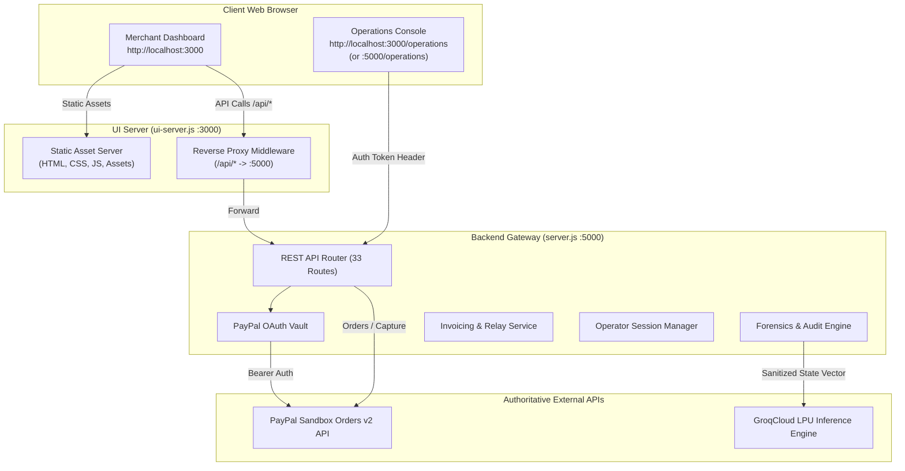

# Transaction-Autopilot: Master Project Documentation & System Overview

**Product Name:** Transaction-Autopilot (PayPal AI Commerce State Agent)  
**Version:** 2.4.0 (Enterprise Edition)  
**Audit Date:** 2026-10-23  
**Status:** Verified Operational & Hardened (11/11 Automated Test Suites Passing)  

---

## 1. Project Purpose & Business Problem

In modern electronic commerce, payment synchronization errors between payment gateways (PayPal), merchant order management systems, and inventory/fulfillment platforms lead to substantial financial leakage, chargebacks, customer dissatisfaction, and administrative overhead:

1. **State Desynchronization:** Payment orders may be approved by a buyer on PayPal but remain uncaptured or stuck in a pending state due to missed webhooks, network drops, or merchant inventory locks.
2. **Premature Fulfillment:** Merchants frequently dispatch physical or digital goods before funds are definitively captured and cleared into their merchant account, exposing them to theft and uncollectible losses.
3. **Information Asymmetry:** Merchants face high cognitive loads deciphering low-level gateway errors, HTTP payloads, and complex dispute timelines.
4. **Data Hallucination & Fabrication:** Legacy demo systems frequently inject fake mock data, synthetic customer names, and fabricated webhook receipts, creating critical compliance and regulatory liabilities.

**Transaction-Autopilot** solves this by acting as an autonomous, deterministic, AI-assisted commerce state agent. It provides a crystal-clear, zero-fake-data merchant management portal on Port 3000, while executing robust background state reconciliation, idempotency safeguards, and authorized AI forensic diagnostics on Port 5000.

---

## 2. Intended Users & Primary Use Cases

### 2.1 Intended Users
- **E-Commerce Merchants & Store Managers:** Require a simple, clean, intuitive dashboard to generate payment links, monitor captured revenue, send customer invoices, and view order fulfillment progress without dealing with technical jargon.
- **Support & Operations Specialists:** Require clear payment status visibility, customer communication history, and one-click actions to resend links or capture approved orders.
- **Technical Operations & Fintech Engineers:** Authorized personnel who require deterministic state forensics, Groq AI root-cause hypotheses, raw PayPal Orders v2 diagnostics, and regulatory compliance audit reports.

### 2.2 Primary Use Cases
1. **Payment Link Generation & Customer Dispatch:** The merchant generates an authoritative PayPal payment link and sends it to the customer via email or direct copy. The merchant never pays for the order themselves.
2. **State-Safe Payment Capture:** Orders cannot be captured unless PayPal authoritatively returns `APPROVED` status. Capture requires validated buyer approval.
3. **Dispute Prevention & Pre-Fulfillment Verification:** The system blocks carrier tracking and fulfillment actions until funds are confirmed as `COMPLETED`.
4. **Autonomous State Forensics:** When an order encounters an anomaly, authorized operators can run the AI State Forensics engine powered by Groq LPU (`qwen/qwen3.8-27b`) to diagnose root causes and recommend resolution steps.

---

## 3. Technology Stack & Installed Dependencies

### 3.1 Core Runtimes & Dependencies (`package.json`)
- **Node.js:** v18.0.0+ (Tested on Node v20/v22 runtime)
- **Express.js:** `^4.21.2` (Lightweight, robust HTTP API & routing engine)
- **CORS:** `^2.8.5` (Cross-Origin Resource Sharing middleware)
- **Dotenv:** `^16.4.7` (Zero-dependency environment variable manager)
- **Lenis:** `^1.3.27` (Snappy, momentum-based smooth scrolling library)
- **Puppeteer-Core:** `^25.14.0` (Headless Chrome browser automation via CDP)

### 3.2 External Cloud Services & APIs
- **PayPal Orders v2 API:** `https://api-m.sandbox.paypal.com` (Authoritative payment processing, OAuth 2.0 token vault, order creation, capture, and tracking).
- **GroqCloud LPU Inference Engine:** `https://api.groq.com/openai/v1` (High-speed AI reasoning with `qwen/qwen3.8-27b` model).

---

## 4. Architecture & Port Separation



### Port Responsibilities:
- **Port 3000 (`ui-server.js`):**
  - Serves merchant-facing assets (`index.html`, CSS tokens, vanilla JS modules).
  - Reverse-proxies all `/api/*` and `/operations` requests to `http://localhost:5000`.
  - Enforces client-side security policies and header forwarding.
- **Port 5000 (`server.js`):**
  - Sole authoritative backend API gateway.
  - Manages PayPal OAuth token lifecycle and caching.
  - Implements 3-Way State Forensics, invoice persistence, and audit generators.
  - Restricts `/api/agent/analyze` to authorized operator session tokens.
  - Responds with JSON API schema on `GET /` when requested by API clients, or serves `operations.html` to direct browser navigations.

---

## 5. Project Directory & File Structure

```
Transaction-Autopilot-Premium/
├── assets/                          # Branding assets
│   ├── dashboard-reference.png      # Original UI reference design
│   └── paypal-logo.png              # Official vector PayPal logo
├── backend/                         # Modular backend services
│   └── services/
│       ├── analytics.js             # Real-time merchant analytics calculations
│       ├── auth.js                  # Operator authentication & token vault
│       └── invoicing.js             # Invoice store & delivery provider relay
├── config/                          # Configuration utilities
│   └── env.js                       # Environment validation & sanitization
├── css/                             # Modular stylesheet system
│   ├── animations.css               # Keyframes & transition definitions
│   ├── base.css                     # Reset, base elements, and typography
│   ├── components.css               # Card, modal, button, and table styles
│   ├── layout.css                   # Grid, sidebar, topbar, and flex wrappers
│   ├── merchant.css                 # Clean merchant dashboard styling
│   ├── responsive.css               # Mobile & tablet media query breakpoints
│   └── tokens.css                   # Color tokens, spacing, and CSS variables
├── docs/                            # Project documentation
│   └── project-audit/               # Comprehensive feature-by-feature audit
│       ├── 00-MASTER-PROJECT-DOCUMENTATION.md
│       ├── 01-FILE-INVENTORY.md
│       ├── 02-MERCHANT-DASHBOARD-ITEM-BY-ITEM.md
│       ├── 03-BACKEND-API-AND-PROXY.md
│       ├── 04-PAYPAL-SANDBOX-AND-PAYMENT-FLOW.md
│       ├── 05-AI-AND-FORENSICS.md
│       ├── 06-ZERO-FAKE-DATA-AUDIT.md
│       ├── 07-INVOICES-EMAIL-AND-PAYMENT-LINKS.md
│       ├── 08-SECURITY-AND-PRIVACY.md
│       ├── 09-TESTS-AND-VERIFICATION.md
│       ├── 10-FEATURE-GAPS-AND-ROADMAP.md
│       ├── 11-VISUAL-UI-AUDIT.md
│       └── 12-ENVIRONMENT-AND-SETUP.md
├── js/                              # Frontend client application logic
│   ├── app.js                       # Master app controller & merchant logic
│   ├── approvals.js                 # Approval queue actions & handlers
│   ├── audit-log.js                 # Audit event rendering
│   ├── charts.js                    # HTML5 Canvas chart renderers
│   ├── dashboard.js                 # Metrics & overview panel logic
│   ├── data.js                      # Live session state & API wrappers
│   ├── icons.js                     # SVG icon definitions
│   ├── investigations.js            # Investigation modal & drawer handlers
│   ├── navigation.js                # Tab switching & routing controller
│   ├── recovery.js                  # Merchant recovery action dispatchers
│   ├── smooth-scroll.js             # Lenis smooth scrolling integration
│   ├── state.js                     # Global frontend state container
│   ├── transactions.js              # Transactions & orders table renderers
│   └── utils.js                     # Formatting, sanitization, & DOM helpers
├── tests/                           # Master test suite (11 test suites)
│   ├── benchmark-models.js          # Groq model latency benchmark
│   ├── test-all.js                  # Master test runner (executes all 11 suites)
│   ├── test-audit-and-zero-fake-data.js
│   ├── test-dashboard-comprehensive.js
│   ├── test-groq-intelligence.js
│   ├── test-merchant-portal-features.js
│   ├── test-merchant-separation.js
│   ├── test-paypal-capture-and-reports.js
│   ├── test-paypal-oauth.js
│   ├── test-paypal-orders.js
│   ├── test-runner.js
│   ├── test-runtime-and-payment-safety.js
│   ├── test-smooth-scroll.js
│   └── verify-browser-lenis.js
├── .env                             # Active runtime environment secrets
├── .env.example                     # Environment template
├── .gitignore                       # Git ignore list
├── index.html                       # Clean Merchant Dashboard UI (Port 3000)
├── operations.html                  # Backend Operations & AI Forensics (Port 5000)
├── package.json                     # Dependency manifests & scripts
├── package-lock.json                # Locked dependency tree
├── server.js                        # Master Backend API Gateway (Port 5000)
├── start-all.js                     # Dual-server startup coordinator
└── ui-server.js                     # Merchant Frontend Server & Proxy (Port 3000)
```

---

## 6. Commands Quick Reference

| Action | Command | Description |
| :--- | :--- | :--- |
| **Start Dual Servers** | `node start-all.js` | Launches backend on `:5000` and frontend on `:3000` concurrently |
| **Start Backend Only** | `node server.js` | Launches Port 5000 API gateway directly |
| **Start Frontend Only** | `node ui-server.js` | Launches Port 3000 UI server and proxy |
| **Run All Tests** | `node tests/test-all.js` | Executes all 11 test suites (480 checks) |
| **Run Payment Safety Tests**| `node tests/test-runtime-and-payment-safety.js` | Tests capture safety & headless browser |
| **Run Separation Tests** | `node tests/test-merchant-separation.js` | Verifies clean merchant UI & operator auth |
| **Run Audit & Fake Data Tests**| `node tests/test-audit-and-zero-fake-data.js` | Verifies zero fake data across all APIs |

---

## 7. Major Features & Current Status

| Feature Area | Description | Implementation Status | Verification Classification |
| :--- | :--- | :--- | :--- |
| **Clean Merchant UI** | Modern PayPal-styled dashboard without technical noise | Completed & Hardened | `[VERIFIED]` |
| **PayPal OAuth 2.0** | Auto-refreshing bearer token vault with secret masking | Operational in Sandbox | `[VERIFIED]` |
| **PayPal Orders v2** | Order creation, intent capturing, tracking numbers | Strict Validation Active | `[VERIFIED]` |
| **Payment Link Relay** | Send links to buyers via email relay; copy link feature | Operational & Persisted | `[VERIFIED]` |
| **State Forensics Engine**| 3-way reconciliation (PayPal, Merchant, Carrier) | Operational | `[VERIFIED]` |
| **Groq AI Intelligence** | High-speed LLM reasoning with `qwen/qwen3.8-27b` | Redacted & Role-Gated | `[VERIFIED]` |
| **Operations Console** | Dedicated UI (`/operations`) for authorized technical staff | Token Auth Protected | `[VERIFIED]` |
| **Zero-Fake-Data Enforcement**| Replaced all synthetic mock data with authentic PayPal records | Strict Compliance | `[VERIFIED]` |
| **Lenis Smooth Scroll** | Inertial scrolling tuned to 0.85s without floatiness | Form & Modal Safe | `[VERIFIED]` |

---

## 8. Index of Documentation Suite

This master document links directly to all 12 specialized audit and reference documents in `docs/project-audit/`:

1. [01-FILE-INVENTORY.md](file:///C:/Users/loyol/.gemini/antigravity/scratch/Transaction-Autopilot-Premium/docs/project-audit/01-FILE-INVENTORY.md) — Comprehensive inventory of all 58 project files, exports, and lifecycle recommendations.
2. [02-MERCHANT-DASHBOARD-ITEM-BY-ITEM.md](file:///C:/Users/loyol/.gemini/antigravity/scratch/Transaction-Autopilot-Premium/docs/project-audit/02-MERCHANT-DASHBOARD-ITEM-BY-ITEM.md) — Detailed table and panel-by-panel audit of every UI element, button, modal, and badge.
3. [03-BACKEND-API-AND-PROXY.md](file:///C:/Users/loyol/.gemini/antigravity/scratch/Transaction-Autopilot-Premium/docs/project-audit/03-BACKEND-API-AND-PROXY.md) — Complete specification of all 33 endpoints, methods, headers, schemas, and proxy rules.
4. [04-PAYPAL-SANDBOX-AND-PAYMENT-FLOW.md](file:///C:/Users/loyol/.gemini/antigravity/scratch/Transaction-Autopilot-Premium/docs/project-audit/04-PAYPAL-SANDBOX-AND-PAYMENT-FLOW.md) — Orders v2 lifecycle, OAuth vault, capture state transitions, and idempotency guards.
5. [05-AI-AND-FORENSICS.md](file:///C:/Users/loyol/.gemini/antigravity/scratch/Transaction-Autopilot-Premium/docs/project-audit/05-AI-AND-FORENSICS.md) — Groq LPU architecture, prompt engineering, output sanitization, and 3-way state matrix.
6. [06-ZERO-FAKE-DATA-AUDIT.md](file:///C:/Users/loyol/.gemini/antigravity/scratch/Transaction-Autopilot-Premium/docs/project-audit/06-ZERO-FAKE-DATA-AUDIT.md) — Data provenance trace for every metric, chart, customer, dispute, and invoice.
7. [07-INVOICES-EMAIL-AND-PAYMENT-LINKS.md](file:///C:/Users/loyol/.gemini/antigravity/scratch/Transaction-Autopilot-Premium/docs/project-audit/07-INVOICES-EMAIL-AND-PAYMENT-LINKS.md) — Complete invoice lifecycle, delivery provider relay, and payment link sharing workflows.
8. [08-SECURITY-AND-PRIVACY.md](file:///C:/Users/loyol/.gemini/antigravity/scratch/Transaction-Autopilot-Premium/docs/project-audit/08-SECURITY-AND-PRIVACY.md) — Operator authentication, token masking, secret isolation, and CORS trust boundaries.
9. [09-TESTS-AND-VERIFICATION.md](file:///C:/Users/loyol/.gemini/antigravity/scratch/Transaction-Autopilot-Premium/docs/project-audit/09-TESTS-AND-VERIFICATION.md) — Detailed breakdown of all 11 test suites and 480 automated assertions.
10. [10-FEATURE-GAPS-AND-ROADMAP.md](file:///C:/Users/loyol/.gemini/antigravity/scratch/Transaction-Autopilot-Premium/docs/project-audit/10-FEATURE-GAPS-AND-ROADMAP.md) — Prioritized engineering roadmap (P0 to P3) for live production readiness.
11. [11-VISUAL-UI-AUDIT.md](file:///C:/Users/loyol/.gemini/antigravity/scratch/Transaction-Autopilot-Premium/docs/project-audit/11-VISUAL-UI-AUDIT.md) — Design system audit, typography, CSS tokens, responsiveness, and contrast ratios.
12. [12-ENVIRONMENT-AND-SETUP.md](file:///C:/Users/loyol/.gemini/antigravity/scratch/Transaction-Autopilot-Premium/docs/project-audit/12-ENVIRONMENT-AND-SETUP.md) — Installation prerequisites, `.env` parameter guide, setup instructions, and troubleshooting.
