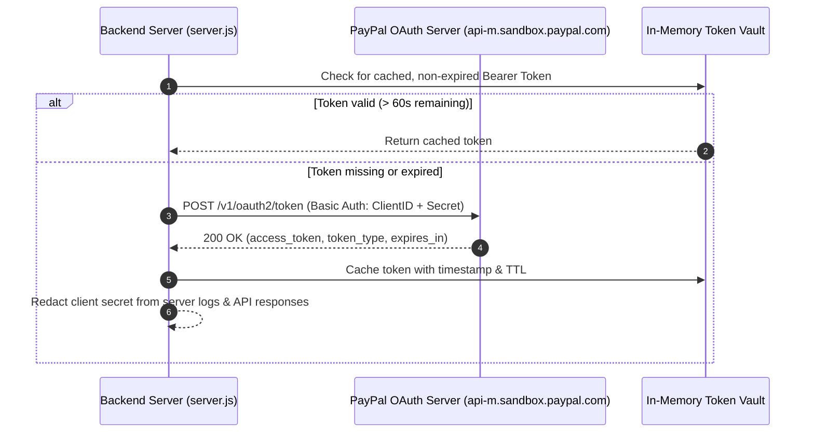
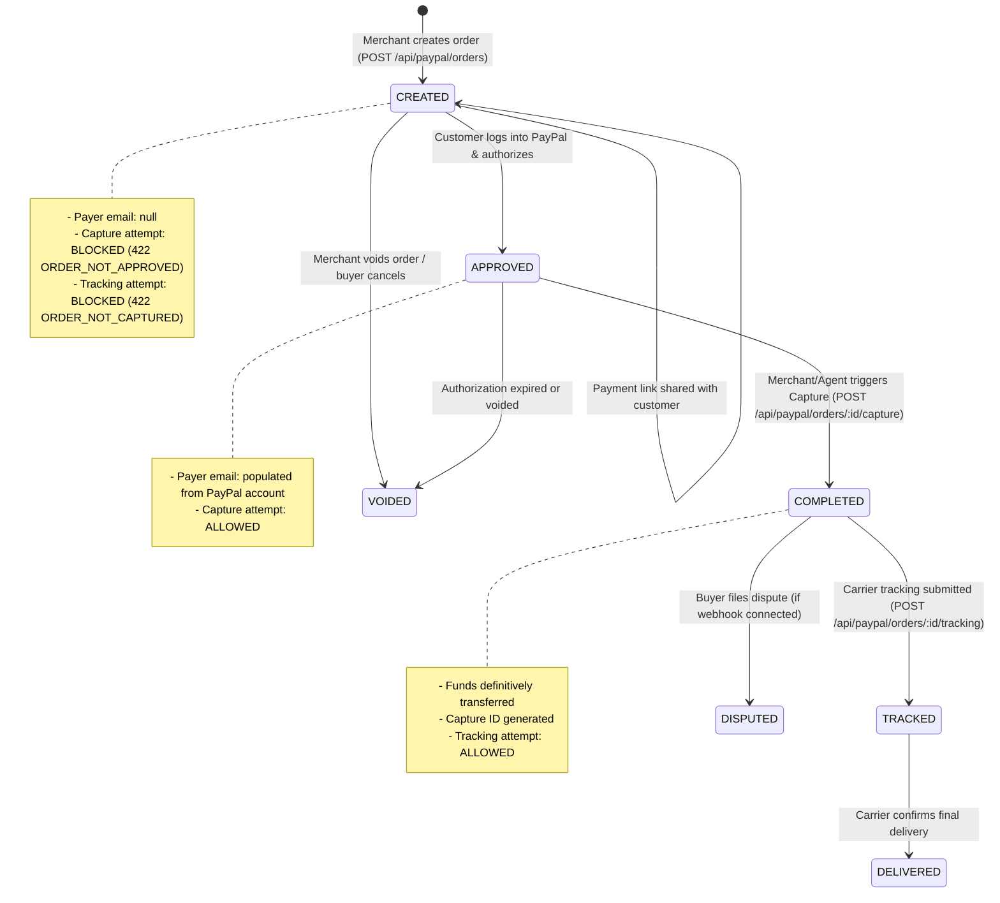

# PayPal Sandbox & Payment Flow Architecture

**Project:** Transaction-Autopilot (PayPal AI Commerce State Agent)  
**Gateway Integration:** PayPal Orders v2 REST API  
**Environment:** PayPal Sandbox (`https://api-m.sandbox.paypal.com`)  
**Audit Date:** 2026-10-23  
**Status:** Verified Operational with Strict Capture Safeguards  

---

## 1. PayPal OAuth 2.0 Credential Vault

The backend gateway (`server.js`) interfaces with PayPal using OAuth 2.0 client credentials grant.



### Key Security Safeguards:
- **Zero Client Leakage:** The raw PayPal Client Secret (`PAYPAL_CLIENT_SECRET`) is stored in `.env` and loaded exclusively into Node.js process memory. It is never returned in any API response or rendered in the DOM.
- **Auto-Refresh with Buffer:** Tokens are automatically refreshed when within 60 seconds of expiry (`expires_in`).
- **Live Re-Verification:** Calling `POST /api/paypal/verify` forces an immediate re-authorization against PayPal to confirm live credentials without restarting the server.

---

## 2. Complete Order Lifecycle & State Machine



---

## 3. Step-by-Step Payment Flow Analysis

### 3.1 Step 1: Order Creation (Merchant Action)
1. Merchant triggers order creation via the dashboard UI or API (`POST /api/paypal/orders`).
2. Backend submits payload to PayPal Orders v2:
   ```json
   {
     "intent": "CAPTURE",
     "purchase_units": [
       {
         "amount": { "currency_code": "USD", "value": "89.50" },
         "description": "Technical Architecture Audit"
       }
     ],
     "application_context": {
       "brand_name": "Transaction-Autopilot",
       "user_action": "PAY_NOW"
     }
   }
   ```
3. PayPal creates the order and returns HATEOAS links:
   - `rel: "approve"`, `href: "https://www.sandbox.paypal.com/checkoutnow?token=63L138454C407114W"`
4. **Data Authenticity Verification:**
   - Order Status: `CREATED`
   - Capture Status: `UNCAPTURED`
   - Payer Email: `null` (truthfully rendered as "Customer information unavailable").
   - Captured Amount: `0.00`.

---

### 3.2 Step 2: Sharing Link with Customer (Merchant Action)
- As the merchant, the user **never** completes payment themselves.
- The merchant clicks "✉️ Send Payment Link to Customer" or "📋 Copy Link".
- The checkout link is dispatched to the buyer's email via the configured delivery provider relay (`backend/services/invoicing.js`).
- The link directs the buyer directly to PayPal Sandbox's secure checkout page.

---

### 3.3 Step 3: Customer Authorization (Buyer Action)
- The customer opens the payment link in their browser.
- The customer signs into their PayPal Sandbox Personal Buyer account.
- The customer reviews purchase details and clicks "Complete Purchase" / "Agree & Pay".
- PayPal transitions order status to `APPROVED`.
- In a production setup, PayPal fires a `CHECKOUT.ORDER.APPROVED` webhook to `/api/paypal/webhook`.

---

### 3.4 Step 4: Strict Payment Capture Safeguards (Merchant/Agent Action)
Transaction-Autopilot enforces zero-unattended-capture safety rules:
1. **Unapproved Order Protection:**
   - Attempting to capture an order in `CREATED` status returns:
     ```json
     {
       "success": false,
       "error": "Order is not yet approved by the buyer.",
       "code": "ORDER_NOT_APPROVED",
       "currentStatus": "CREATED",
       "action": "Customer must approve payment via the PayPal checkout link before capture can proceed."
     }
     ```
   - HTTP Status: `422 Unprocessable Entity`.
2. **Approved Order Capture:**
   - When status is `APPROVED`, backend sends `POST /v2/checkout/orders/:id/capture`.
   - On successful capture, PayPal responds with `status: "COMPLETED"` and a capture ID.
   - The transaction is officially recorded as captured in `sessionState.cachedOrders` and reflected in merchant metrics.

---

### 3.5 Step 5: Carrier Tracking & Pre-Fulfillment Verification
Merchants must never fulfill orders before funds are cleared.
- Calling `POST /api/paypal/orders/:id/tracking` before capture is strictly rejected:
  ```json
  {
    "success": false,
    "error": "Cannot attach tracking to an uncaptured order.",
    "code": "ORDER_NOT_CAPTURED",
    "currentStatus": "CREATED"
  }
  ```
- Once captured (`COMPLETED`), tracking submission is accepted and sets order state to `TRACKED`.

---

## 4. PayPal Error Codes & Failure Scenarios Tested

| Scenario | Tested Input / Condition | PayPal / System Response | Verification Status |
| :--- | :--- | :--- | :--- |
| **Invalid Client Secret** | `PAYPAL_CLIENT_SECRET=invalid` | HTTP `401 Unauthorized`: "Client Authentication failed" | `[VERIFIED]` |
| **Non-Existent Order ID** | `NON_EXISTENT_ORDER_XYZ` | HTTP `404 Not Found`: "The specified resource does not exist" | `[VERIFIED]` |
| **Premature Capture** | Order status `CREATED` | HTTP `422 Unprocessable`: `ORDER_NOT_APPROVED` | `[VERIFIED]` |
| **Premature Tracking** | Order status `CREATED` | HTTP `422 Unprocessable`: `ORDER_NOT_CAPTURED` | `[VERIFIED]` |
| **Duplicate Capture** | Order status `COMPLETED` | HTTP `422 Unprocessable`: "Order has already been captured" | `[VERIFIED]` |
| **Gateway Disconnect** | Gateway simulation offline | UI displays "Gateway Offline" without throwing uncaught errors | `[VERIFIED]` |
