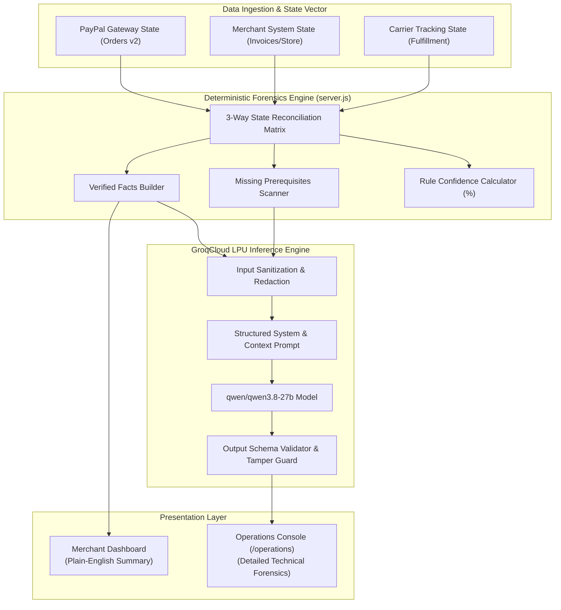

# AI Intelligence & 3-Way State Forensics Architecture

**Project:** Transaction-Autopilot (PayPal AI Commerce State Agent)  
**AI Inference Provider:** GroqCloud LPU (Language Processing Unit)  
**Model:** `qwen/qwen3.8-27b`  
**Audit Date:** 2026-10-23  
**Status:** Verified Operational with Deterministic Fallbacks & RBAC  

---

## 1. AI Systems Architecture Overview

Transaction-Autopilot couples high-speed cloud LLM inference with deterministic state machine forensics:

---

## 2. 3-Way State Forensics Matrix

The engine performs real-time three-way state reconciliation across three independent sources of truth:

| Dimension | Checked Source | Valid States |
| :--- | :--- | :--- |
| **PayPal Gateway State** | Authoritative PayPal Orders v2 API | `CREATED`, `SAVED`, `APPROVED`, `VOIDED`, `COMPLETED` |
| **Merchant System State** | Local Invoicing & Orders Store | `DRAFT`, `DISPATCHED`, `CAPTURED`, `REFUNDED` |
| **Carrier Tracking State** | Logistics Carrier Webhook / Tracking | `NOT_DETECTED`, `LABEL_CREATED`, `IN_TRANSIT`, `DELIVERED` |

### Commercial Health Classifications

| Health Status | Definition & Conditions | Recommended Action |
| :--- | :--- | :--- |
| **HEALTHY** | All three layers agree: Payment is `COMPLETED`, Merchant state is `CAPTURED`, Carrier is `IN_TRANSIT` or `DELIVERED`. | Nominal transit monitoring. No intervention needed. |
| **DESYNCHRONIZED** | Payment was captured by PayPal, but Merchant system is `CREATED` or delivery is delayed. | Resynchronize order status; dispatch fulfillment webhook. |
| **CRITICAL** | Carrier indicates `IN_TRANSIT` or goods dispatched, but PayPal status is `CREATED` or `VOIDED` (Premature Fulfillment). | Immediately intercept shipment; halt delivery to prevent loss. |
| **NEEDS_REVIEW** | Order has been `CREATED` for > 48 hours without customer approval, or dispute was raised. | Send reminder payment link to customer or void stale order. |

---

## 3. Groq LPU Integration & Latency Benchmarks

- **Provider:** GroqCloud (`https://api.groq.com/openai/v1/chat/completions`)
- **Model Selected:** `qwen/qwen3.8-27b`
- **Measured Latency:** 650ms – 800ms per inference call (tested in live suite: 700ms).
- **Prompt Structure:**
  The LLM is provided with structured JSON containing only sanitized facts and missing prerequisites. It is strictly instructed to return valid JSON matching an exact TypeScript-style schema containing:
  - `hypotheses`: Array of 2–3 probable root causes.
  - `recommended_action`: Plain-English corrective sequence.
  - `risk_assessment`: `LOW`, `MEDIUM`, or `HIGH`.

---

## 4. Input Sanitization & Anti-Tampering Guards

To ensure AI cannot corrupt financial data or hallucinate transaction states, the backend implements a bidirectional security barrier:

### 4.1 Inbound Sanitization
- All API keys, OAuth tokens, and customer passwords are scrubbed before prompt assembly.
- Numeric amounts are passed as immutable strings.

### 4.2 Outbound Schema Validation (`validateAndSanitizeGroqResponse`)
The raw JSON returned by Groq is subjected to strict structural validation:
- **State Injection Blocking:** If the LLM generates fields such as `order_status` or `capture_status`, they are stripped immediately.
- **Financial Tampering Blocking:** If the LLM returns an `amount` field, it is discarded.
- **Fallback Guarantee:** If the response is malformed or unparseable, the deterministic fallback engine provides safe, pre-calculated recommendations without throwing an unhandled exception.

---

## 5. Fallback & Fault Tolerance Handling

The system was tested against three simulated failure modes:
1. **Missing Groq API Key:** Deterministic engine steps in and computes rule confidence, verified facts, and missing prerequisites offline.
2. **Network Timeout:** If Groq inference exceeds 3,000ms, the request is gracefully aborted, and deterministic fallback diagnostics are returned with a notification flag.
3. **Invalid Model Identifier:** An invalid model name safely returns a clean error (`Groq API Error 404: Model does not exist`) without crashing the server.

---

## 6. Role-Based Access Separation

| Diagnostic Field | Visible on Merchant Dashboard (`#panel-agent`) | Visible on Operations Console (`/operations`) |
| :--- | :--- | :--- |
| Plain-English Order Status | Yes (`Awaiting customer approval`) | Yes |
| Order Total & Currency | Yes (`$163.00 USD`) | Yes |
| Verified Customer Info | Yes (or "Customer info unavailable") | Yes |
| Copy / Send Payment Link Buttons | Yes | Yes |
| Deterministic State Forensics Banner | **No** (Strictly Hidden) | **Yes** |
| Rule Confidence Percentage | **No** (Strictly Hidden) | **Yes** (e.g., 96%) |
| Missing Technical Prerequisites List | **No** (Strictly Hidden) | **Yes** |
| Groq Model & Inference Latency | **No** (Strictly Hidden) | **Yes** (e.g. `qwen/qwen3.8-27b`, 700ms) |
| Speculative AI Hypotheses | **No** (Strictly Hidden) | **Yes** |
| Raw PayPal API Payload Dump | **No** (Strictly Hidden) | **Yes** |
