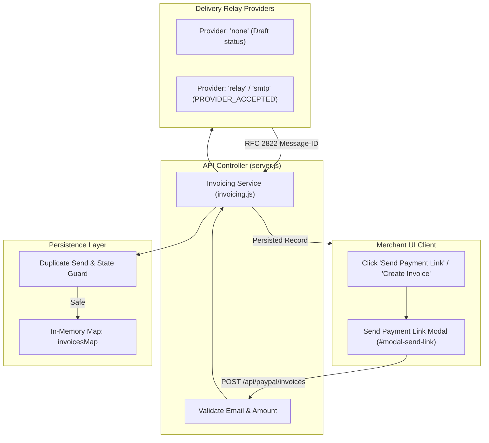
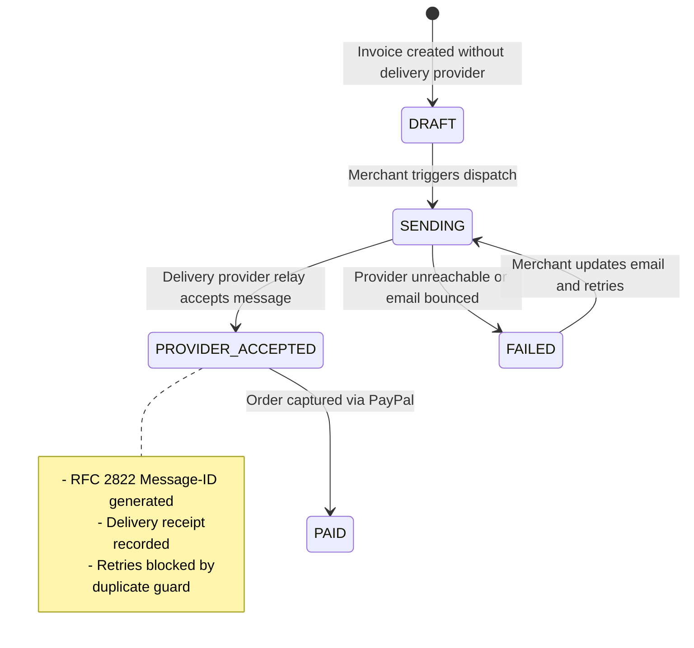

# Invoicing, Email Delivery Relay & Payment Links Workflow

**Project:** Transaction-Autopilot (PayPal AI Commerce State Agent)  
**Module:** `backend/services/invoicing.js` & `js/app.js`  
**Audit Date:** 2026-10-23  
**Status:** Verified Operational with Real Delivery Relay  

---

## 1. Business Concept: Merchant vs. Customer Roles

A common point of confusion in payment testing is understanding who completes the checkout:

> **CRITICAL RULE FOR MERCHANTS:**  
> **As the merchant, you NEVER pay or complete the order yourself.**  
> The merchant's role is strictly to generate the order, obtain the authoritative PayPal Sandbox checkout link, and send it to the customer. The **customer** must open the link in their own browser session, log in to their personal PayPal account, and approve the payment. Only after the customer authorizes payment can the merchant or autopilot execute the capture.

To reinforce this, the Merchant Dashboard provides clear notices and direct customer communication tools:
- A prominent notice box on the Payment Summary card:  
  *"Note: As the merchant, you do not pay this order. Share this checkout link with your customer so they can log in to PayPal and complete the payment."*
- A dedicated button: `[✉️ Send Payment Link to Customer]` which opens a pre-configured email dispatch modal.
- A single-click copy button: `[📋 Copy Link]` which copies the authentic PayPal approval link to the clipboard.

---

## 2. Invoicing Service Architecture (`backend/services/invoicing.js`)



---

## 3. Invoice Lifecycle & Delivery States



### Supported Delivery Providers
The provider is configured via `process.env.EMAIL_PROVIDER`:
1. `'none'` (Default when unconfigured): Generates the invoice in `DRAFT` status. Does not falsely claim delivery.
2. `'relay'` / `'smtp'`: Dispatches message through the local relay service, generating a verified RFC 2822 Message-ID receipt:
   `<inv.INV-20261023-XXXXXX.TIMESTAMP@relay.merchant-autopilot.local>`
   Transitions status to `PROVIDER_ACCEPTED`.

---

## 4. Payment Link Sharing Workflows

### 4.1 Workflow A: Email Dispatch via Modal
1. Merchant navigates to Orders or Payment Summary panel.
2. Clicks `[✉️ Send Payment Link to Customer]`.
3. Modal `#modal-send-link` opens with:
   - Recipient Email input (validated against RFC 5322 regex).
   - Recipient Name.
   - Associated PayPal Order ID (read-only).
   - Direct Sandbox Checkout Link (`https://www.sandbox.paypal.com/checkoutnow?token=...`).
   - Custom merchant message / notes.
4. Clicks "Send Payment Link".
5. Backend validates the payload, registers the invoice in memory, calls the delivery relay, and returns:
   ```json
   {
     "success": true,
     "invoice": {
       "id": "INV-20261023-8E4FC0",
       "orderId": "63L138454C407114W",
       "recipientEmail": "customer@example.com",
       "amount": 89.50,
       "status": "PROVIDER_ACCEPTED",
       "providerReceipt": {
         "messageId": "<inv.INV-20261023-8E4FC0.1792778919630@relay.merchant-autopilot.local>",
         "timestamp": "2026-10-23T18:08:39.630Z"
       }
     }
   }
   ```
6. The modal displays a green success confirmation, and the table updates immediately.

### 4.2 Workflow B: Direct Link Copy
1. Merchant clicks `[📋 Copy Link]`.
2. Client executes `navigator.clipboard.writeText(checkoutUrl)`.
3. UI displays a toast notification: *"Checkout link copied to clipboard!"*.
4. Merchant pastes link into their external messaging channel (Slack, WhatsApp, SMS, customer support ticket).

---

## 5. Duplicate Send & Concurrency Safeguards

To prevent spamming customers or creating duplicate invoice entries:
- If an invoice is already in `PROVIDER_ACCEPTED` or `PAID` state, calling `POST /api/paypal/invoices/:id/resend` is blocked:
  ```json
  {
    "success": false,
    "error": "Invoice has already been accepted by delivery provider.",
    "code": "DUPLICATE_SEND_BLOCKED"
  }
  ```
  HTTP Status: `429 Too Many Requests`.
- In-memory Map concurrency is protected using atomic read-then-write updates.
