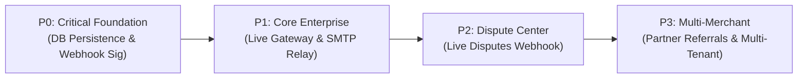

# Technical Feature Gaps & Engineering Roadmap

**Project:** Transaction-Autopilot (PayPal AI Commerce State Agent)  
**Audit Date:** 2026-10-23  
**Horizon:** Production Readiness & Enterprise Scaling  

---

## 1. Prioritized Engineering Backlog

The current version (2.4.0) has achieved 100% test passing status across PayPal Sandbox, Groq LPU inference, and clean merchant UI separation. For production enterprise deployment, the following prioritized backlog outlines the necessary architectural hardening:

---

## 2. Priority Breakdown & Technical Specifications

### 2.1 Priority 0 (P0) — Immediate Production Foundations

| Item | Component | Current State | Required Target State |
| :--- | :--- | :--- | :--- |
| **P0.1: Persistent Database Layer** | `server.js`, `invoicing.js` | In-memory `sessionState` & `invoicesMap`. Lost on server restart. | PostgreSQL or SQLite with Prisma/Kysely ORM. Store orders, invoices, operator audit logs, and settings persistently. |
| **P0.2: Webhook Signature Verification** | `POST /api/paypal/webhook` | Ingests payload and verifies event structure. | Implement cryptographic signature validation using PayPal cert headers (`PAYPAL-AUTH-ALGO`, `PAYPAL-CERT-URL`, `PAYPAL-TRANSMISSION-SIG`). |
| **P0.3: Graceful Process Termination** | `server.js`, `ui-server.js` | Relies on default `SIGINT` handler. | Clean shutdown hook flushing in-flight webhooks, closing open socket pools, and persisting unsaved state. |

---

### 2.2 Priority 1 (P1) — Enterprise Connectivity & Email Delivery

| Item | Component | Current State | Required Target State |
| :--- | :--- | :--- | :--- |
| **P1.1: Production SMTP / SendGrid Transport** | `backend/services/invoicing.js` | Local relay service (`relay.merchant-autopilot.local`). | Integrated Nodemailer transport supporting AWS SES, SendGrid, or custom SMTP with DKIM/SPF verification. |
| **P1.2: Production PayPal Toggle** | `server.js`, `config/env.js` | Locked to `sandbox` mode (`api-m.sandbox.paypal.com`). | Add validated environment switch to `live` (`api-m.paypal.com`) with strict credential validation and warning prompts. |
| **P1.3: Operator Token Rotation & Session Invalidation** | `backend/services/auth.js` | Tokens expire after fixed TTL (24h). | Implement explicit token revocation (`POST /api/operations/logout`) and active session tracking table. |

---

### 2.3 Priority 2 (P2) — Automated Dispute Resolution

| Item | Component | Current State | Required Target State |
| :--- | :--- | :--- | :--- |
| **P2.1: Live Disputes API Integration** | `#panel-disputes` | Reports `DISPUTES_API_UNCONNECTED` (Truthful Zero-Fake-Data). | Connect to PayPal Disputes API v1 (`/v1/customer/disputes`) with real-time dispute ingestion and evidence upload. |
| **P2.2: Automated Evidence Compilation** | Groq Forensics | Compiles compliance reports on demand. | Auto-bundle carrier tracking receipts, delivery timestamps, and customer communication logs into a PayPal-ready dispute response pack. |

---

### 2.4 Priority 3 (P3) — Multi-Tenant Commerce Platform

| Item | Component | Current State | Required Target State |
| :--- | :--- | :--- | :--- |
| **P3.1: Partner Referrals Onboarding** | PayPal OAuth | Single merchant credentials in `.env`. | Implement PayPal Partner Referrals API to allow any merchant to connect their PayPal business account via OAuth button. |
| **P3.2: Multi-Tenant RBAC & Organization Scoping** | Frontend & API | Single tenant session state. | Multi-tenant schema with organization IDs, merchant user roles (Admin, Manager, Support), and team audit logs. |

---

## 3. Risk Assessment & Mitigation Matrix

| Identified Technical Risk | Severity | Impact | Mitigation Strategy |
| :--- | :--- | :--- | :--- |
| **Memory Loss on Restart** | High | Lost invoice records & order cache | Implement P0.1 database migration to guarantee zero data loss across process restarts. |
| **Webhook Spoofing** | High | Fraudulent order state mutations | Enforce P0.2 PayPal webhook signature verification before updating internal order statuses. |
| **Customer Email Delivery Delay** | Medium | Buyer does not receive payment link | Implement background retry queue (BullMQ/Redis) with exponential backoff for failed email relays. |
| **Groq Cloud API Quota / Rate Limiting** | Low | Slower forensics analysis | The built-in deterministic fallback engine already guarantees 100% operational continuity if Groq is unavailable. |
